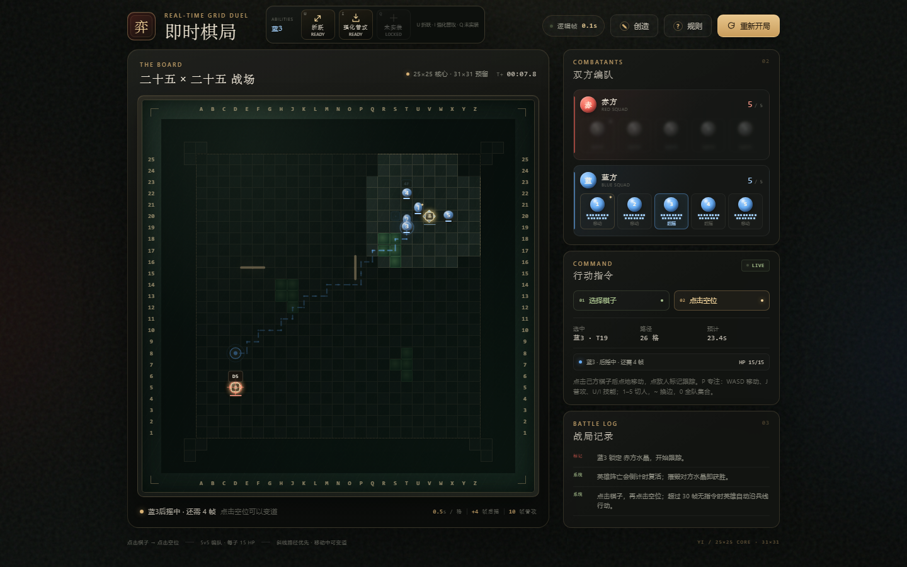
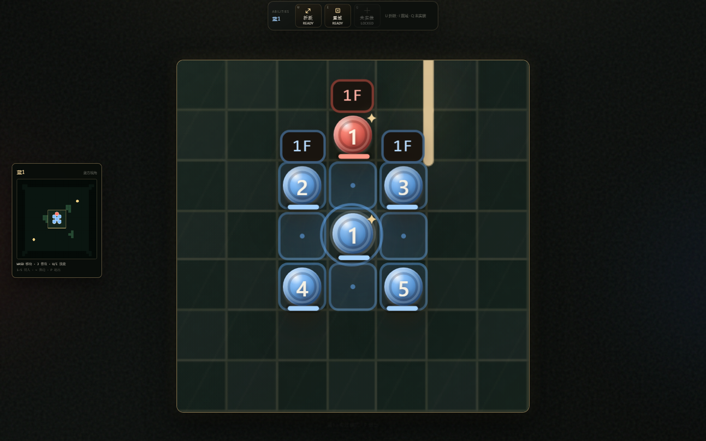
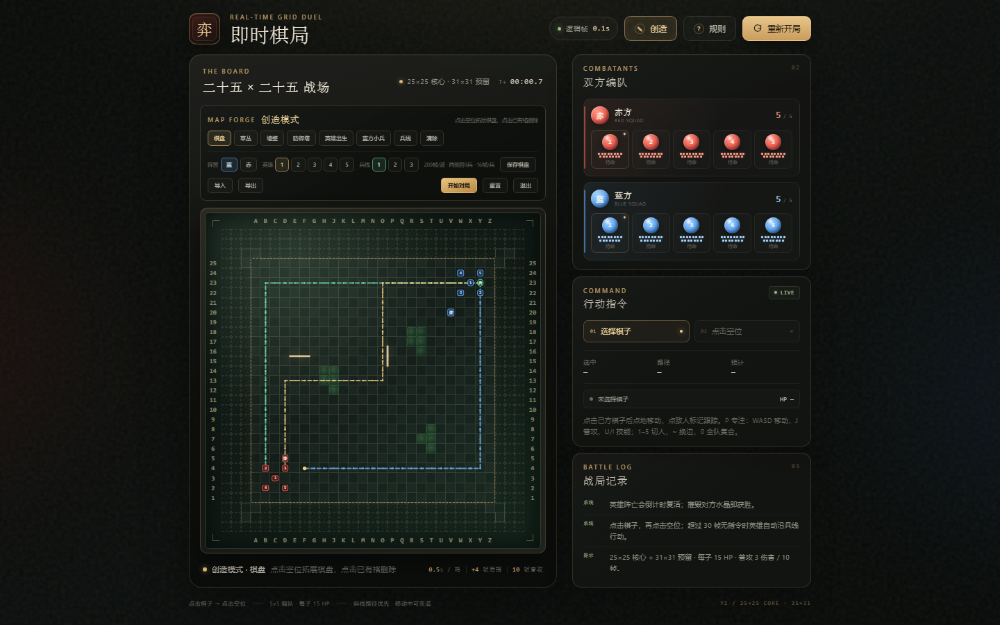

# 弈 · 即时棋局 25×25 核心 / 31×31 预留

一个可直接在浏览器中运行的实时多单位战棋：25×25 核心棋盘、31×31 设计预留空间、5v5 编队、草丛视野、防御塔、兵线小兵、墙壁、地图创造模式与升级棋子技能。

## 运行

直接双击 `index.html`，或双击 `启动游戏.bat`。无需构建、依赖或联网。

> 注意：Edge/Chrome 之间、`file://` 与 `http://localhost` 之间的 `localStorage` 互不共享。换浏览器或换打开方式后如果看不到存档，请在创造模式用「导入 / 导出」迁移棋盘。

## 基础操作

1. 点击己方棋子选中；点击空位移动，点击敌方棋子/小兵/防御塔会标记目标并自动跟踪。
2. 移动途中可再次选中该棋子并点击其他空位，在下一格变道；下达移动或变道后自动取消选中。
3. 静止棋子会警戒周围 8 格，自动攻击范围内敌人，优先级为小兵 → 英雄 → 防御塔。
4. 超过 30 帧没有收到指令时，英雄自动沿兵线行动。
5. 按 `P` 进入/退出专注模式：`W/A/S/D` 移动，`J` 普攻，`U/I` 技能。
6. 按 `1`–`5` 切换锁定英雄；按 `~` 在蓝方/赤方视角之间切换；按 `0` 后点击地图，全队集合。
7. 英雄阵亡后按时间复活；摧毁对方水晶获胜。顶部「创造」进入地图编辑。

## 专注模式

- 选中己方英雄后按 `P` 进入，再按 `P` 或 `Esc` 退出。
- `W/A/S/D` 逐格移动，`J` 普攻；范围内没有敌人时普攻不生效。
- `J` 支持预输入：当前攻击/后摇结束后会自动衔接下一次普攻。
- 技能快捷键为 `U`（一技能）、`I`（二技能）、`Q`（三技能，未实装）。
- 专注模式下棋盘放大为锁定英雄的 7×7 视口，始终以该英雄为中心；侧栏、战报和页面其余部分收起。
- 小地图独立放在棋盘左侧，不遮挡棋盘；英雄与建筑在小地图上使用放大的标记。
- 按 `1`–`5` 会切换到对应英雄并继续保持专注；`~` 换边时同步切换相同编号英雄。

## 目标跟踪与集合

- 选中己方棋子后点击敌方单位，会显示锁定标记并自动追击；目标死亡、进入不可见草丛或下达新指令后解除。
- 按 `0` 进入集合指令状态，再点击地图任意位置，当前视角队伍所有英雄会前往集合点。
- 通过点击地面移动后，英雄自主行动时会先寻找距离自己最近的兵线，再沿该兵线推进。

## 战争迷雾

- 默认蓝方视角；按 `~` 切换赤方。
- 视野来源：己方英雄 7×7、己方防御塔攻击范围、己方小兵索敌范围。
- 视野外只保留敌方防御塔、草丛、墙壁与地形；敌方英雄/小兵隐藏。
- 同一草丛内的单位可见；草丛中单位攻击后暴露 30 帧。
- 视野外覆盖半透明黑色块；专注模式仅保留锁定英雄的 7×7 视野。

## 数值

| 项目 | 数值 |
| --- | --- |
| 棋盘 | 25 × 25 核心，31 × 31 预留；四角向外扩展 |
| 逻辑帧 | 0.1 秒 |
| 英雄生命 | 15 HP |
| 英雄普攻 | 3 点伤害，每 10 帧一次 |
| 英雄移动 | 0.5 秒 / 格，落点后摇 4 帧 |
| 英雄复活 | 8 秒起，随游戏时间增长至 60 秒 |
| 升级技能 | 震域伤害 8 点；强化普攻伤害 3 点 |
| 防御塔 | 45 HP，菱形射程，优先小兵 |
| 小兵 | 3 HP，8 帧 / 格，1 点伤害 |
| 每波小兵 | 每侧 9 个，每条兵线 3 个，间隔 16 帧 |

## 草丛与视野

- 相邻草丛自动连成同一片（八方向相邻）。
- 草丛中的棋子半透明。
- 不同草丛中的单位无法自动索敌草丛中的目标；技能仍可命中。
- 草丛中的棋子发动攻击后会暴露 30 帧，头顶显示眼睛图标。
- 同一片草丛中的单位可以互相看见。

## 防御塔

- 45 HP。
- 射程为以自身为中心的菱形：`|Δ行| + |Δ列| ≤ 3`，包含中心 3×3 并向上下左右各延伸两格。
- 优先攻击小兵；对小兵造成 1 点伤害，对英雄棋子造成 2 点伤害。
- 每 10 帧攻击一次。

## 小兵与兵线

- 小兵 3 HP、1 点伤害、8 帧移动一格。
- 索敌范围 3×3；索敌后 5×5 内持续追击，超出 5×5 放弃。
- 攻击范围为自身及上下左右各一格（十字形）。
- 15 帧一个攻击循环：前摇 3 帧、后摇 12 帧；前摇期间目标离开攻击范围可以躲开。
- 未索敌且索敌范围内无敌人时，返回最近的兵线路径并沿路径前进。
- 小兵只被墙壁和棋盘边界阻挡；可以与其他小兵、英雄、防御塔重叠。

### 三路双向兵线

- 共有 **3 条兵线**，每条都是双向的：蓝方小兵从蓝方小兵点出发，赤方小兵从该兵线的另一端出发，双方沿同一路径反向推进。
- 每 **200 帧** 产生一波兵：双方各生成 **9 个小兵**，每条兵线各 3 个，每个小兵生成间隔 **16 帧**。
- 蓝方小兵默认从蓝方小兵刷新点出发；赤方小兵从三条兵线的赤方终点出发。

## 英雄复活

- 英雄被击败后留在原地显示复活倒计时，倒计时结束在己方对应出生点满血复活。
- 复活时间按游戏时间计算：
  - 0–4 分钟：从 8 秒开始，每 30 秒约提升 11%，4 分钟达到 20 秒。
  - 4–20 分钟：逐渐增长到 46 秒。
  - 20–35 分钟：每分钟增加 1 秒，最高 60 秒。
  - 35 分钟后固定 60 秒。
- 所有时间按 0.1 秒逻辑帧四舍五入。

## 英雄自动行动

- 超过 **30 帧** 没有收到玩家指令时，英雄自动行动。
- 索敌范围为以自身为中心的 **7×7**。
- 目标优先级：敌方小兵 → 敌方英雄 → 敌方防御塔。
- 视野内出现敌方英雄时，只有自身生命高于对方才会靠近攻击，否则沿兵线后撤。
- 没有友方小兵进入敌方防御塔范围时，英雄不会进入该塔范围；会自动走到兵线上离目标塔最近的安全位置。
- 兵线分配：1/2 号走一号兵线，3/4 号走三号兵线，5 号走二号兵线；双方推进方向相反。

## 英雄技能

技能快捷键：`U` 一技能、`I` 二技能、`Q` 三技能（未实装）。

- **1 号**：折跃（U，冷却 900 帧）；震域（I，前摇 10 帧、后摇 3 帧、伤害 8、冷却 60 帧）。
- **3 号**：折跃（U，冷却 900 帧）；强化普攻（I，冷却 90 帧，下三次普攻伤害 3，攻击范围为曼哈顿距离 3）。3 号普攻伤害为 2，攻击范围为塔射程（曼哈顿距离 3）。
- **2 / 4 号**：复苏（U，冷却 900 帧，无前后摇）。为自己和 5×5 范围内血量最低的英雄恢复 20% 最大生命（向上取整）；自主行动时恢复量减半，范围内有英雄生命低于 50% 时自动触发。
- **5 号**：无技能。

## 水晶

- 每方最靠近己方 5 号英雄出生点的防御塔会被标记为水晶。
- 水晶生命耗尽时游戏立即结束，另一方获胜。

## 墙壁

- 墙壁沿格子边线放置，阻挡普通移动和寻路。
- 折跃作为瞬移可以越过墙壁；墙壁不阻挡攻击与技能。

## 创造模式

点击顶部「创造」后：

- **棋盘**：在 31 × 31 预留空间中点击空位扩展，点击已有格删除；25 × 25 核心用虚线框标出，四角只做向外扩展。
- **草丛**：点击格子放置/移除草丛。
- **墙壁**：点击格子边线放置/拆除墙壁。
- **防御塔**：点击格子放置塔，再点同一格拆除；使用「阵营」切换赤/蓝。
- **英雄出生**：选择阵营与 1–5 号槽位，为每一方设置 **5 个英雄出生点**。
- **蓝方小兵**：设置蓝方小兵刷新点；三条兵线默认从此处出发。
- **兵线**：共有 3 条；选择第 1/2/3 条后，起点自动为蓝方小兵点，移动鼠标绘制路径，再点击赤方终点确认。
- **清除**：清空地形、塔、双方英雄出生点与三条兵线。
- 波次固定为每 200 帧，双方各 9 个小兵（每条兵线 3 个）、每 16 帧生成一个；点击「开始对局」应用地图并重开。
- **保存棋盘**：把当前编辑中的设计写入浏览器本地存储，下次打开页面自动载入；覆盖前会把旧版本备份到 `yi-board-design-v1-backup`。
- **导入 / 导出**：导入 `.json` 棋盘文件，或把当前设计导出为 JSON，便于跨浏览器/跨来源恢复。
- 「重置」恢复默认 25×25 核心 + 四角扩展地图；「退出」放弃本次编辑。

## 胜利条件

每方最靠近己方 5 号出生点的防御塔为水晶。摧毁对方水晶即获胜；英雄被击败不会结束对局，会按复活时间回城。

## 文件

- `index.html`：页面结构
- `styles.css`：棋盘、地形、技能 HUD、创造模式与动画样式
- `game.js`：地图、寻路、草丛、防御塔、小兵、战斗、迷雾、专注与渲染
- `screenshot.png`：战争迷雾与目标跟踪
- `screenshot-focus.png`：专注模式、7×7 视野与小地图
- `screenshot-editor.png`：创造模式与保存棋盘
- `启动游戏.bat`：Windows 下快速打开

核心参数位于 `game.js` 顶部的 `CONFIG`、`MINION_CONFIG`、`TOWER_CONFIG`、`RESPAWN_CONFIG`、`LANE_CONFIG`、`SKILL_LIBRARY` 与 `TEAM_DEFS`。

